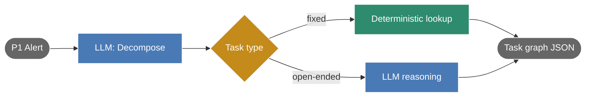

# S1 — Task Decomposition (hand-built, Ollama)

Given an alert, asks the LLM to decompose the investigation into subtasks and label each one
`fixed` (deterministic lookup) or `open-ended` (requires reasoning). Outputs a JSON task graph.

## Step Diagram

> LLM labels each subtask as fixed or open-ended and builds a JSON task graph before execution.

## Status

`TODO` — implement `decompose.py`
