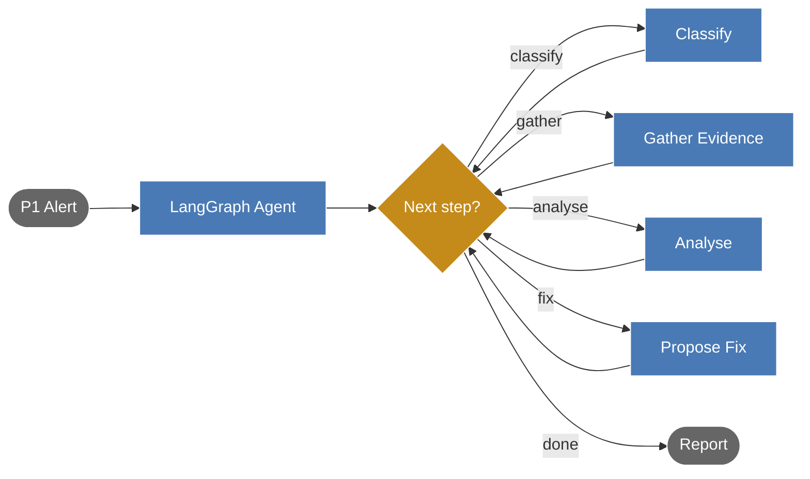

# S1 — Dynamic Agent (LangGraph, Ollama)

The same five steps as `[s1]-[fixed-pipeline]` but as a LangGraph agent with open-ended routing.
Outputs a side-by-side comparison: steps taken, token count, and quality score for both approaches.

## Step Diagram

> Same five steps as fixed-pipeline but routed dynamically by LangGraph — the agent decides the order.

## Status

`TODO` — implement `agent.py`
