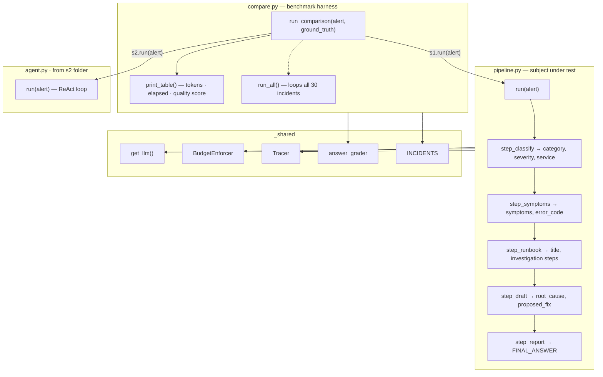

# S1 — Fixed Pipeline (hand-built, Ollama)

Five LLM calls in a fixed sequence. No branching, no tool calls, no loops.
Every incident goes through exactly the same five steps regardless of what the alert says.

```
alert → classify → symptoms → runbook → draft → report
```

| Step | Input | Output |
|---|---|---|
| 1. classify | alert text | `{category, severity, affected_service, confidence}` |
| 2. symptoms | alert + classification | `{symptoms[], error_code, time_window}` |
| 3. runbook | classification + symptoms | `{runbook_title, investigation_steps[], escalation_path}` |
| 4. draft | all above | `{root_cause, proposed_fix, escalation_needed, confidence}` |
| 5. report | all above | `FINAL_ANSWER / EVIDENCE / PROPOSED_FIX` text |


## Step Diagram


> Five LLM calls in a fixed sequence. No branching, no loops — every alert takes the same path.

## Files



## Run

```bash
# default alert (payment-api OOM)
python pipeline.py

# custom alert
python pipeline.py "ALERT: db-primary replication lag 45 minutes. Severity: P1."

# side-by-side comparison with S2 ReAct loop
python compare.py

# compare all 30 incidents
python compare.py --all
```

## Expected output

```
Alert: ALERT: payment-api pod restarted 3 times in 10 minutes. Last exit code 137. Severity: P1.

  [classify]   820 ms  |  312+48 tokens
  [symptoms]   710 ms  |  398+62 tokens
  [runbook]    930 ms  |  445+89 tokens
  [draft]      880 ms  |  512+72 tokens
  [report]     740 ms  |  480+96 tokens

--- Result ---
FINAL_ANSWER: payment-api was OOM-killed (exit code 137) because heap usage reached 96% of its 4096 MB limit
EVIDENCE: classification, symptom-analysis, runbook-lookup, draft-response
PROPOSED_FIX: Increase payment-api memory limit to 6144 MB and investigate heap leak

Steps: 5  |  Tokens: 2147+367  |  Time: 4.08s
```

## Comparison table (single alert)

```
────────────────────────────────────────────────────
Metric                          S1 Pipeline   S2 ReAct
────────────────────────────────────────────────────
LLM calls                                 5          3
Prompt tokens                          2147          —
Completion tokens                        367          —
Elapsed (s)                            4.08       1.82
Quality score                         0.612      0.741
────────────────────────────────────────────────────

S1 root cause: payment-api was OOM-killed (exit 137) — heap at 96% of 4096 MB limit
S2 root cause: OOM kill: payment-api exceeded 4096 MB memory limit
S2 tools used: search_logs, check_metrics
```

## Key observation

S1 uses 5 LLM calls vs. S2's 2–4 tool calls + 1 final answer call.
S1's quality is lower because it reasons from the alert text alone — no log or metric evidence.
S2's quality is higher because it gathers real evidence before concluding.

This is the core tradeoff the roadmap is teaching: **fixed pipelines are predictable but evidence-blind**.

## Next steps

- **S1 dynamic agent** — `[s1]-[dynamic-agent]-[langgraph]-[ollama]`: same five steps as a LangGraph agent with open-ended routing
- **S2 react loop** — already implemented: the evidence-gathering version
