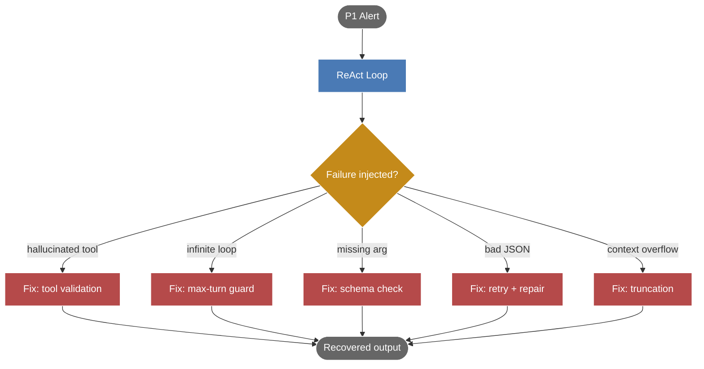

# S2 — Failure Modes (hand-built, Ollama)

Five deliberate failure injections into the ReAct loop from `[s2]-[react-loop]`, each with a first fix:

| # | Failure | Symptom | Fix |
|---|---|---|---|
| 1 | Malformed arguments | JSON parse error on tool call | Catch + retry with schema hint in next message |
| 2 | Repeated identical calls | Same tool + same args twice | Detect repeat, inject "you already called this" message |
| 3 | Early final answer | FINAL_ANSWER before any tool call | Require at least one tool call before accepting final answer |
| 4 | Runaway loop | No progress after 5 steps | Force a summary prompt if no FINAL_ANSWER after N steps |
| 5 | Hallucinated tool name | LLM invents a tool not in TOOLS | Reject unknown tool name, return error observation |

## Step Diagram

> Five deliberate failure injections into the ReAct loop, each with a targeted fix.

## Status

`TODO` — implement `failure_modes.py`
