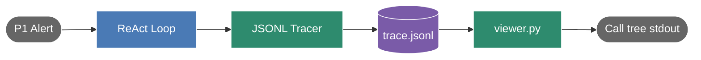

# S2 — Loop Tracing (hand-built, Ollama)

Same ReAct loop as `[s2]-[react-loop]` with `TRACE=1` enabled by default.
Adds a `viewer.py` that reads the JSONL trace and renders a call tree to stdout.

```
run s2-react-loop-abc123
├── step_0  reasoning          12 ms
├── step_1  search_logs        34 ms   keyword=OOM
├── step_2  check_metrics      28 ms   service=payment-api
└── step_3  final_answer       45 ms
```


## Step Diagram



> Same ReAct loop with TRACE=1 — every thought, action and observation written to JSONL, rendered as a call tree.

## Status

`TODO` — implement `viewer.py` (agent.py copies from s2-react-loop with TRACE forced on)
