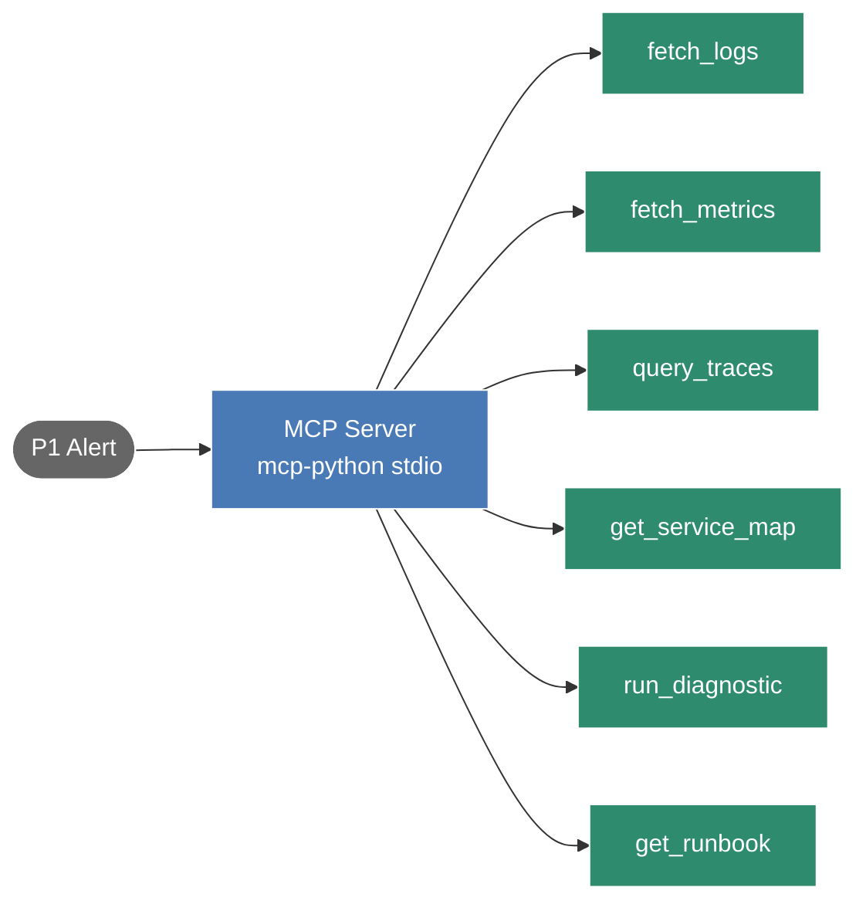

# S3 — MCP Server (mcp-python, Ollama)

Six incident-domain tools behind a Python MCP stdio server.
Implements the `mcp` Python SDK server pattern with one tool per investigation capability.

| Tool | Description |
|---|---|
| `search_logs` | Keyword search over synthetic log store |
| `check_metrics` | Last-5-min metrics for a service |
| `get_deploy_history` | Recent deploys for a service |
| `lookup_runbook` | Runbook procedure by topic |
| `query_incident_db` | Query SQLite episodic memory (from S4) |
| `draft_fix` | Formats a fix proposal for human approval (from S7) |

Run as a standalone server: `python server.py`
Connect from Claude Desktop or any MCP client.

## Step Diagram

> Six incident-domain tools exposed via MCP stdio transport using the Python MCP SDK.

## Status

`TODO` — implement `server.py`
