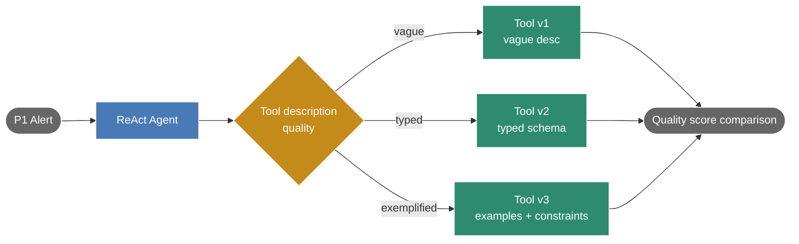

# S3 — Tool Design (hand-built, Ollama)

Demonstrates how tool description quality affects agent behaviour.
Runs the same alert through three versions of each tool description:

| Version | Description quality | Expected behaviour |
|---|---|---|
| v1 | Name only: `search_logs` | Agent guesses when to call it |
| v2 | What it does | Agent calls it more reliably |
| v3 | What + when + what it returns | Agent calls it correctly with right args |

Outputs a table: tool description version → tool selection accuracy over 10 incidents.

## Step Diagram

> Same alert, three versions of tool descriptions — shows how description quality drives tool-call accuracy.

## Status

`TODO` — implement `tool_design.py`
