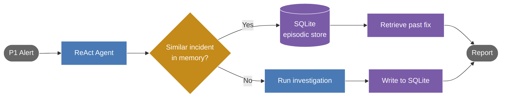

# S4 — Episodic Memory (SQLite, Ollama)

SQLite table of solved incidents. After each run the agent writes:
`(alert_hash, root_cause, fix, tools_used, quality_score, ts)`

On a new alert, retrieves the top-3 most similar past incidents by keyword match
and injects them into the system prompt as "similar past incidents".

Compares pass rate with and without memory on the 30-incident replay set.

## Step Diagram

> SQLite stores alert_hash, root_cause, fix, tools_used, quality_score — keyword match for retrieval.

## Status

`TODO` — implement `agent.py` and `memory_store.py`
