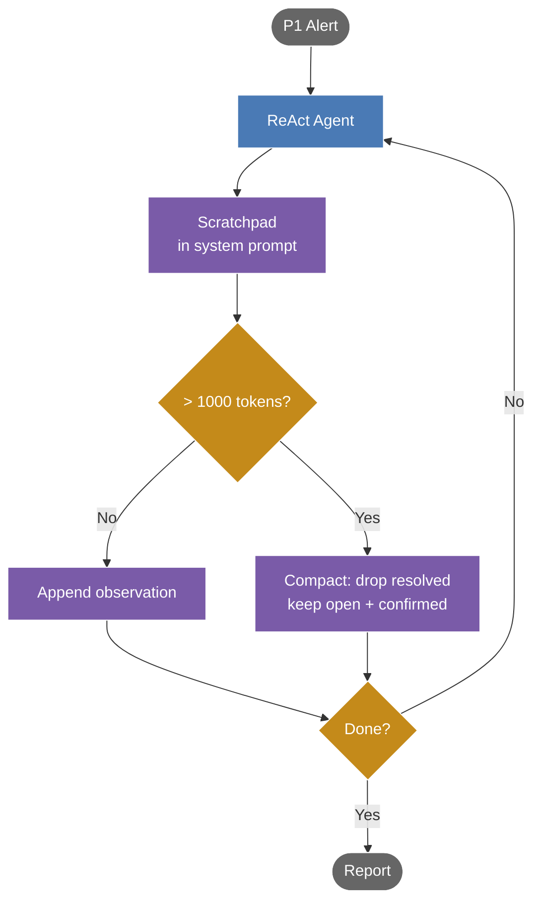

# S4 — Scratchpad Memory (hand-built, Ollama)

In-context scratchpad: the agent appends observations to a running JSON block in the system prompt.
When the scratchpad exceeds 1000 tokens, a compaction step drops resolved observations and
keeps only open questions and confirmed facts.

Demonstrates working memory management without any external store.

## Step Diagram

> In-context scratchpad compacted when it exceeds 1 000 tokens — keeps only open questions and confirmed facts.

## Status

`TODO` — implement `agent.py`
