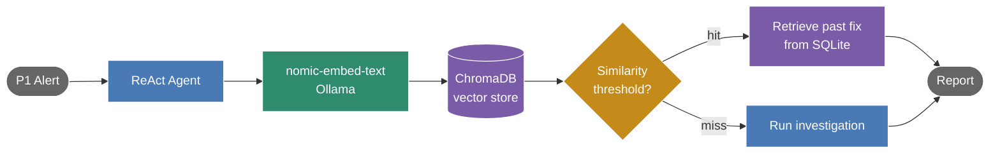

# S4 — Semantic Memory (ChromaDB, Ollama)

Same SQLite episodic memory as `[s4]-[episodic-memory]` but retrieval uses
ChromaDB + `nomic-embed-text` (Ollama) instead of keyword match.

Runs the same 30-incident replay and compares retrieval quality:
keyword recall vs. embedding recall vs. no memory baseline.

## Step Diagram

> ChromaDB + nomic-embed-text replaces keyword match — retrieval is now semantic similarity.

## Status

`TODO` — implement `agent.py` and `semantic_store.py`
