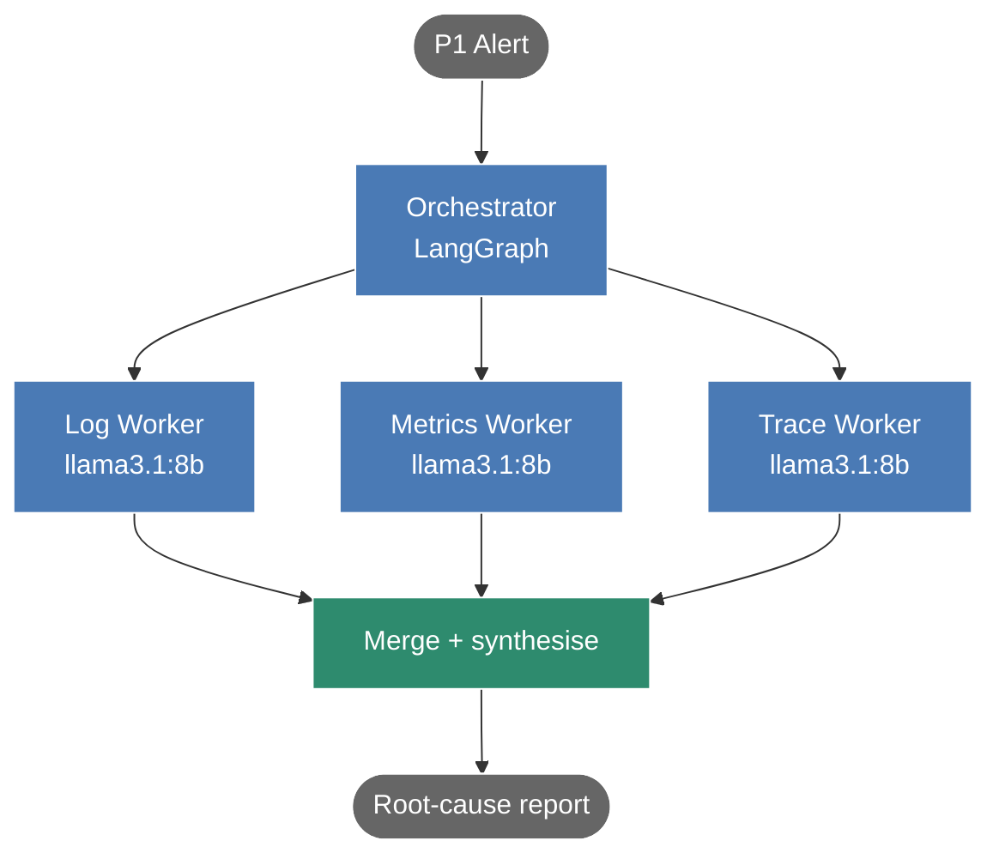

# S5 — Orchestrator-Worker (LangGraph, Ollama)

Orchestrator receives an alert and fans out to three parallel workers:

| Worker | Job | Output |
|---|---|---|
| `triage_worker` | Classify severity and category | `{severity, category, confidence}` |
| `log_worker` | Search logs for evidence | `{log_lines, keywords_found}` |
| `runbook_worker` | Fetch relevant procedure | `{runbook_title, steps}` |

Workers run in parallel (LangGraph `Send` API). Orchestrator merges results and writes
the final `RootCauseReport` as structured JSON.

## Step Diagram

> Orchestrator fans out to three parallel workers then merges their evidence into one report.

## Status

`TODO` — implement `agent.py`
