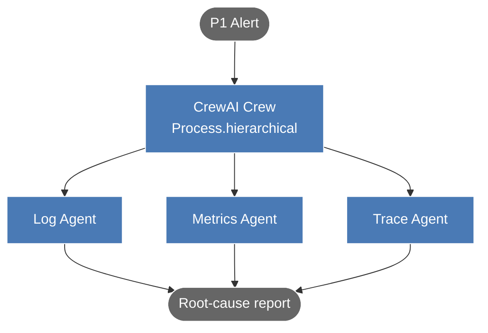

# S5 — Parallel Workers (CrewAI, Ollama)

Same three workers as `[s5]-[orchestrator-worker]` implemented as a CrewAI Crew
with `Process.hierarchical`. Benchmarks latency vs. sequential CrewAI execution.

## Step Diagram

> Same three workers as orchestrator-worker, implemented as a CrewAI hierarchical Crew.

## Status

`TODO` — implement `crew.py`
