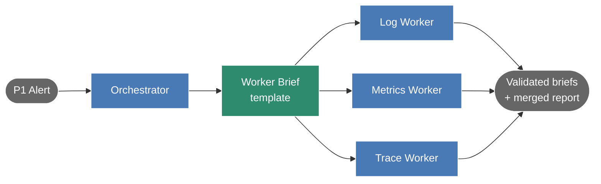

# S5 — Worker Briefs (hand-built, Ollama)

Documents and validates the worker brief template:

```
objective:      what this worker must produce
output_format:  exact JSON schema the orchestrator expects
allowed_tools:  list of tool names this worker may call
scope_boundary: what this worker must NOT do
```

Runs the same alert with and without the brief. Scores output schema adherence
(does the JSON match the expected schema?) and root cause quality.


## Step Diagram



> Documents and validates the worker brief template — the contract between orchestrator and workers.

## Status

`TODO` — implement `worker_briefs.py`
