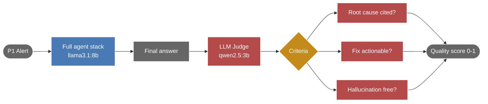

# S6 — Answer Grader (LLM judge, Ollama)

Uses `qwen2.5:3b` as a cheap local LLM judge to grade final answer quality:

| Criterion | Prompt asks | Score |
|---|---|---|
| Root cause correct | Does the answer identify the root cause from ground truth? | 0–1 |
| Fix plausible | Is the proposed fix a sensible remediation? | 0–1 |
| Evidence cited | Does the answer mention which tools/evidence were used? | 0–1 |

Composite score = mean of three criteria. Pass threshold: ≥ 0.67.

## Step Diagram

> qwen2.5:3b judges llama3.1:8b output on three criteria — cheaper judge, full agent under test.

## Status

`TODO` — implement `answer_grader_llm.py`
