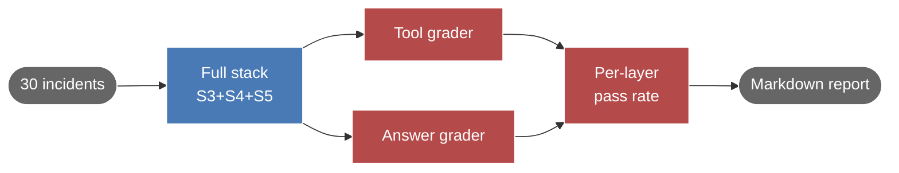

# S6 — Replay Suite (custom, Ollama)

Runs all 30 synthetic incidents through the full agent stack (S3 tools + S4 memory + S5 workers).
Records per-layer pass rate and outputs a Markdown report.

```
Replay Suite Results — 2026-11-17
==================================
Category       Total   Tool ✓   Answer ✓   Trajectory ✓
network           10     9/10      8/10         8/10
database          10     8/10      7/10         7/10
deployment        10     9/10      8/10         8/10
TOTAL             30    26/30     23/30        23/30
```

Fail cases are listed with the gap: expected tools vs. actual tools called.


## Step Diagram



> Runs all 30 synthetic incidents through the full stack and reports per-layer pass rates.

## Status

`TODO` — implement `replay.py`
