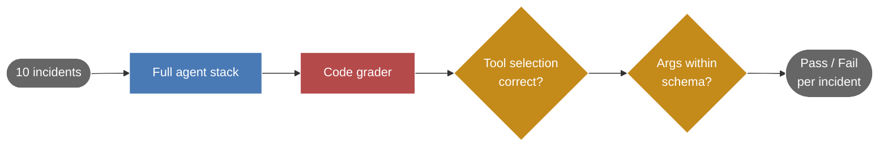

# S6 — Tool Grader (code, Ollama)

Code-based grader (no LLM judge). For 10 incidents from `_shared/incident_generator.py`:

1. **Tool selection** — did the agent call the expected tools from `evidence_sources`?
2. **Argument schema** — are tool arguments valid JSON with required keys?

Outputs a Markdown table: incident ID → tool_selection pass/fail → argument pass/fail.

Uses `_shared/grader.py::tool_selection_grader` and `argument_grader`.

## Step Diagram

> Code-based grader — no LLM. Checks tool selection and argument schema against expected values.

## Status

`TODO` — implement `run_grader.py`
