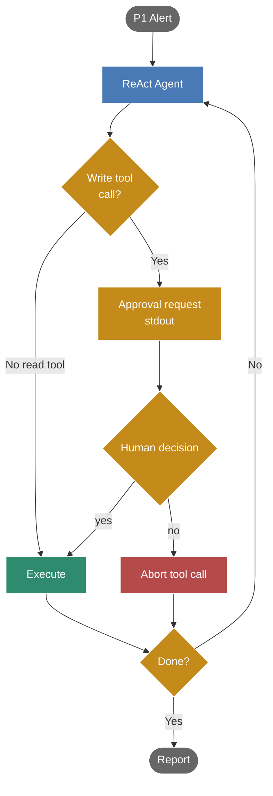

# S7 — Approval Gate (hand-built, Ollama)

Separates tools into read-only and write categories. Before any write tool call,
the loop pauses and emits an approval request to stdout. Resumes on `yes`, aborts on `no`.

| Category | Tools | Gate |
|---|---|---|
| Read-only | `search_logs`, `check_metrics`, `get_deploy_history`, `lookup_runbook`, `query_incident_db` | None — auto-approved |
| Write | `draft_fix` | Requires human `yes` before execution |

Demonstrates HITL (Human-in-the-loop) for the write path only.

## Step Diagram

> Loop pauses before any write-category tool call and waits for human yes / no on stdin.

## Status

`TODO` — implement `agent.py`
