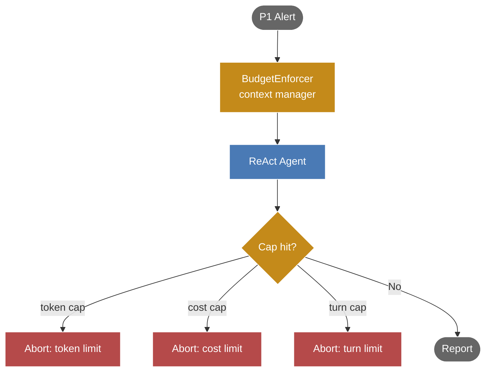

# S7 — Budget Enforcer (hand-built, Ollama)

Wraps any agent with `_shared/budget.py::BudgetEnforcer`. Demonstrates three caps:

| Cap | Default | On exceed |
|---|---|---|
| Step count | 25 | `BudgetExceeded: step cap reached` |
| Wall-clock time | 300 s | `BudgetExceeded: time cap reached` |
| Estimated token cost | $0.50 proxy | `BudgetExceeded: cost cap reached` |

Runs the same alert with caps set low to trigger each failure. Shows the error and partial result.

## Step Diagram

> BudgetEnforcer wraps any agent and enforces token, cost, and turn caps — raises on exceed.

## Status

`TODO` — implement `budget_demo.py`
