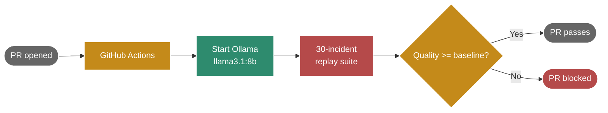

# S7 — Eval Gate in CI (GitHub Actions, Ollama)

GitHub Actions workflow that runs the 30-incident replay suite on every PR.
Fails the PR if quality regresses:

| Check | Threshold |
|---|---|
| Trajectory pass rate | < 75% fails |
| Tool selection pass rate | < 85% fails |
| Any category drop > 10% vs. baseline | fails |

Requires a self-hosted runner with Ollama installed, or a container with Ollama sidecar.

## Step Diagram

> GitHub Actions runs the replay suite on every PR — fails the merge if quality regresses.

## Files

- `.github/workflows/eval_gate.yml` — workflow definition
- `run_eval_gate.py` — entry point, writes `eval_results.json`
- `check_thresholds.py` — reads `eval_results.json`, exits non-zero on regression

## Status

`TODO` — implement workflow and scripts
