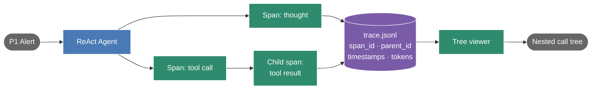

# S7 — JSONL Tracing (hand-built, Ollama)

Full JSONL trace with span model: `span_id`, `parent_id`, timestamps, tool input/output, token counts.
Extends the basic tracer from `[s2]-[loop-tracing]` with nested spans and a tree viewer.

```bash
TRACE=1 python agent.py
python viewer.py traces/run-abc123.jsonl
```

```
run abc123  total 847 ms  3 steps
├─ step_0  reasoning        45 ms   tokens: 312+28
├─ step_1  search_logs      34 ms   keyword=137      result_lines=1
│  └─ tool_dispatch         12 ms
├─ step_2  check_metrics    28 ms   service=payment-api
│  └─ tool_dispatch          9 ms
└─ step_3  final_answer     740 ms  tokens: 892+156
```


## Step Diagram



> Full span model with span_id, parent_id, timestamps, and token counts written to JSONL.

## Status

`TODO` — implement `viewer.py` (agent.py copies s2-react-loop with richer span data)
